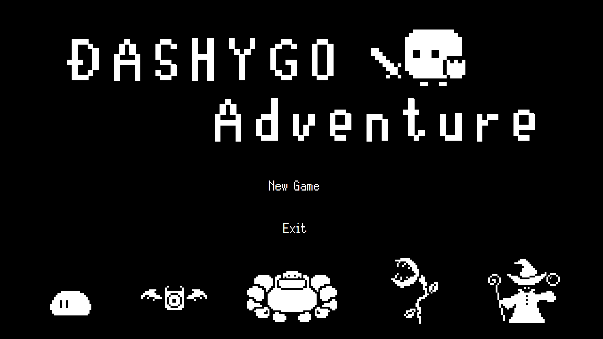
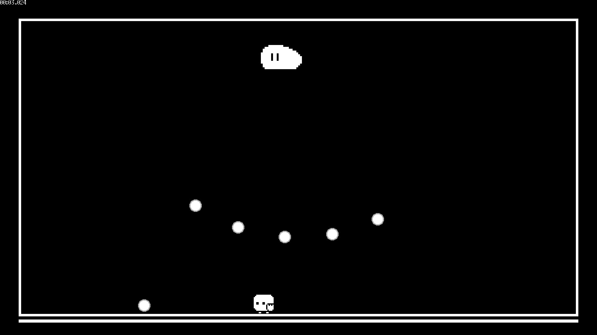

# DASHYGO Adventure

用純 Java（Swing）從零打造的 2D 像素風彈幕動作遊戲。玩家用鍵盤移動、衝刺，再用**滑鼠甩動**揮劍反彈子彈、向前突刺，連續擊敗五個關卡的魔物。



> 高中專題作品（臺北市立大安高工，2022）。雖然是分組專題，除了原版背景音樂由組員製作外（公開版已換成原創音樂，見「美術與音樂」），程式、角色美術與動畫都是我完成的。
>
> 完整的專題實作報告（含架構圖、流程圖、開發過程遇到的問題與解法）：[docs/report.pdf](docs/report.pdf)

## 遊戲畫面



## 玩法

| 操作 | 動作 |
| --- | --- |
| `A` / `D` | 左右移動 |
| `Space` | 衝刺 |
| 滑鼠從畫面最左端快速甩到最右端（或反向） | **揮劍**：反彈碰到的子彈 |
| 滑鼠從畫面最下方快速甩到最上方 | **前衝攻擊** |
| `Esc` | 暫停（繼續 / 重來 / 回標題） |

- 衝刺、揮劍、前衝攻擊都會消耗體力，體力會隨時間回復
- 共五關，玩家只有一條命，失敗就要從第一關重來
- 左上角計時器記錄通關總時間
- **練習模式**：在標題畫面點選下方任一隻魔物，即可單獨挑戰該關

### 關卡與魔物

| 關卡 | 魔物 | 攻擊方式 |
| --- | --- | --- |
| 1 | Slime 史萊姆 | 噴射黏液彈 |
| 2 | Demon 惡魔 ×2 | 會追蹤玩家的火球 |
| 3 | Golem 石巨人 | 投擲岩石、落石 |
| 4 | FlyTrap 捕蠅草 | 種子彈、地面荊棘 |
| 5 | Wizard 巫師 | 火球、冰槌、落雷、荊棘的綜合攻擊 |

範圍型攻擊（落石、落雷、荊棘）發動前會先出現警示區域，讓玩家有反應時間。

## 技術重點

完全使用 JDK 內建的 Swing / AWT 與 Java Sound，沒有使用任何遊戲引擎或外部函式庫，碰撞、幾何運算、動畫都是自己實作。

### 自製 2D 幾何與碰撞偵測

Java 內建的 `Point`、`Polygon` 只支援整數座標，也沒有向量類別和碰撞偵測，所以自己寫了 [`doubleshape2d`](src/doubleshape2d) 套件：

- `DoublePoint`、`DoubleVector`、`DoublePolygon`、`DoubleCircle`：支援浮點數座標的點、向量（內積、外積、法向量）、多邊形、圓形
- [`Collision.java`](src/doubleshape2d/Collision.java) 以 **GJK（Gilbert–Johnson–Keerthi）演算法** 判斷兩個凸多邊形、或多邊形與圓形是否碰撞：
  1. 用支撐函數（support function）求兩形狀在某方向上的最遠點，得到 Minkowski 差上的一點
  2. 逐步建立 simplex（點 → 線段 → 三角形），每次依目前 simplex 決定下一個搜尋方向
  3. 若 simplex 包住原點代表兩形狀重疊；若新點無法越過原點則代表沒有碰撞
- **掃掠多邊形（swept polygon）**：把物件上一幀與這一幀的位置連成一個多邊形再做碰撞判定，避免高速移動的子彈在兩幀之間直接「穿過」玩家

### 遊戲迴圈與多執行緒

- 三條執行緒各自以固定週期運作：
  - **計算執行緒**（約 6ms 一次）：玩家移動、子彈與攻擊更新、碰撞判定、關卡推進
  - **繪圖執行緒**：依計算結果重繪畫面
  - **滑鼠偵測執行緒**（1ms 一次）：Swing 內建的滑鼠移動事件反應太慢，改成高頻率輪詢游標位置，用「多短時間內移動多遠」判斷甩動手勢
- 跨執行緒共用的資料以 `synchronized` 保護；子彈、敵人等清單使用 `CopyOnWriteArrayList`，讓遍歷時也能安全移除元素

### 物件設計

- 以抽象類別 `Character`、`Enemy`、`Bullet`、`EnemyAttack` 統一介面，各種魔物與子彈繼承後只需實作自己的行為
- 每個物件用 enum 記錄目前狀態，再搭配整數記錄狀態內的階段，組成簡單的狀態機（出生 → 攻擊 → 死亡動畫…）

### 瞄準與追蹤

- **瞄準**：用 `atan2` 算出敵人到玩家的角度
- **追蹤彈**：火球每一幀只朝玩家方向轉固定的小角度。最初版本是每幀直接重新瞄準，結果玩家幾乎無法閃躲，改成限制轉向速度後才有躲避空間

### 其他

- 依螢幕解析度等比縮放，以 1920×1080 為基準設計，支援其他 16:9 螢幕
- 圖片旋轉、翻轉、殘影等效果以 `Graphics2D` 自行處理
- 所有圖片、音樂、音效都打包在 jar 內，以 `getResourceAsStream` 讀取

## 美術與音樂

- 角色、子彈、特效：在 [Pixilart](https://www.pixilart.com/) 繪製角色，再用 [Piskel](https://www.piskelapp.com/) 製作逐格動畫
- 背景音樂與音效：原版的背景音樂由組員以 Online Sequencer 製作，但其中部分曲目改編自網站上其他人的作品、授權無法確認，因此公開版把**全部 6 首背景音樂與 15 個音效**換成以程式合成的原創 8-bit 版本（方波主旋律、方波琶音、三角波貝斯、雜訊鼓），產生程式在 [`tools/audio/`](tools/audio)
- 字型：[Silver](https://poppyworks.itch.io/silver)，© 2019 Poppy Works（Itou Hiro、Yoon Design、Wolfgang Wozniak），以 [CC BY 4.0](https://creativecommons.org/licenses/by/4.0/) 授權，檔案為 `src/Images/AfterImage/Pixel.ttf`

## 執行方式

需要 JDK 8 以上（當年以 JDK 19 開發，已確認可用 JDK 27 編譯）。遊戲會以全螢幕執行，建議使用 16:9 螢幕。

```bash
javac -encoding UTF-8 -d bin $(find src -name "*.java")
cp -r src/Images src/Musics src/Sounds bin/
java -cp bin panels.MainFrame
```

### 使用 IntelliJ IDEA

1. File → Open，選擇專案資料夾，出現提示時選擇以 Eclipse 專案匯入
2. File → Project Structure → Project，SDK 選 JDK 8 以上
3. 執行 `src/panels/MainFrame.java` 的 `main`

## 專案結構

```
src/
├── panels/          # 視窗與各畫面：標題、遊戲、暫停、失敗、通關
├── character/       # 玩家與五種魔物
├── bullet/          # 各種子彈（黏液彈、火球、岩石、種子、冰槌）
├── enemyattack/     # 範圍攻擊（落石、落雷、荊棘）與警示
├── animation/       # 玩家動畫（衝刺殘影、揮劍、攻擊）
├── doubleshape2d/   # 自製 2D 幾何類別與 GJK 碰撞偵測
├── Images/          # 像素圖與字型
├── Musics/          # 背景音樂
└── Sounds/          # 音效
tools/
└── audio/           # 產生背景音樂與音效的合成程式（Python + NumPy）
```
